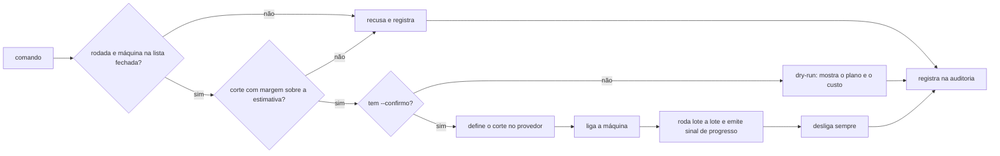

# Operação segura de rodadas pagas: dry-run, catálogo fechado, corte de tempo e auditoria

> **English summary.** How to run long, paid batch jobs (simulations, training runs, ETL) so that nothing spends money without a human "yes", the job is not killed before it finishes, and you can reconstruct what happened afterwards. A small CLI with a *simulated* cloud provider shows six controls: a closed catalog of jobs and machines, dry-run by default, a time cut-off set at the provider (with a minimum margin over the estimate), always-off in the `finally` block, a progress beacon with a diagnosis, and an append-only audit log. Pure Python, no dependencies, all data synthetic (a project-schedule Monte Carlo as the workload).

Pergunta de abertura: se uma rodada custa dinheiro e roda por horas, **como garantir que nada gaste sem o seu "sim", que ela não seja cortada antes de terminar e que dê para saber depois exatamente o que aconteceu?**

**Status:** estudo concluído (v1), com provedor simulado. O objetivo é mostrar o desenho dos controles, não uma integração com nuvem.

## Conteúdo

| Caminho | O que é |
|---|---|
| `rodadas.py` | A CLI: `status`, `estimar`, `lancar`, `progresso`, `desligar`, `auditoria`. |
| `provedor_simulado.py` | Um "provedor de nuvem" de brinquedo (estado em JSON). Para usar um provedor real, troque esta classe. |
| `carga_montecarlo.py` | A carga do exemplo: risco de prazo de um projeto fictício. |
| `config.json` | Máquinas permitidas e preços (créditos fictícios), margem mínima do corte, limite de "sem sinal". |
| `catalogo.json` | A lista **fechada** de rodadas que a CLI aceita executar. |
| `teste_rodadas.py` | 10 testes das travas. |
| `LICENSE` | MIT. |

## Como funciona



Seis controles, cada um com um motivo:

1. **Lista fechada.** A CLI só executa rodadas do `catalogo.json` e máquinas do `config.json`. Não existe "rodar este comando".
2. **Dry-run por padrão.** Sem `--confirmo`, o `lancar` só mostra o plano, a estimativa e o teto de custo.
3. **Corte de tempo no provedor, com margem.** O corte é definido **antes** de ligar e vale mesmo se a carga travar. A CLI recusa um corte menor que 1,2 vez a estimativa, porque uma máquina cortada antes do fim cobra o tempo todo e não entrega o resultado.
4. **Desligar sempre.** O desligamento fica num bloco `finally`: ocorre em sucesso, em erro e em corte.
5. **Sinal de progresso e diagnóstico.** A carga grava a cada lote quantos lotes estão prontos. O `progresso` cruza isso com o estado da máquina e diz se está rodando, terminou ou caiu.
6. **Auditoria só de acréscimo.** Cada comando vira uma linha JSON, **inclusive os dry-runs e as exceções** (como `--sem-margem`).

## Sessão de exemplo

Saída real da CLI, com o provedor simulado e dados sintéticos:

```text
$ python rodadas.py status
maquina-a  DESLIGADA  4.00/h
maquina-b  DESLIGADA  6.50/h

$ python rodadas.py estimar prazo-rapida
Rodada:   prazo-rapida - Risco de prazo de um projeto de implantacao (versao rapida)
Maquina:  maquina-a
Estimativa: 2.0 h  ->  ~8.0 creditos
Corte:      3.0 h  ->  teto 12.0 creditos
Margem do corte sobre a estimativa: OK (minimo 1.2x)

$ python rodadas.py lancar prazo-rapida
PLANO: prazo-rapida na maquina-a | estimativa 2.0 h (~8.0 cred.) | corte 3.0 h (teto 12.0 cred.)
DRY-RUN: nada foi ligado nem executado. Para executar, repita com --confirmo.

$ python rodadas.py lancar prazo-rapida --corte-horas 2.1 --confirmo
PLANO: prazo-rapida na maquina-a | estimativa 2.0 h (~8.0 cred.) | corte 2.1 h (teto 8.4 cred.)
RECUSADO: o corte (2.1 h) e menor que 1.2x a estimativa (2.0 h). A maquina seria desligada antes de a rodada terminar. Aumente o corte, ou use --sem-margem (fica registrado).

$ python rodadas.py lancar prazo-rapida --confirmo
PLANO: prazo-rapida na maquina-a | estimativa 2.0 h (~8.0 cred.) | corte 3.0 h (teto 12.0 cred.)
CONCLUIDA (prazo-rapida_20261124T061142): 2.0 h cobradas, custo 8.0 creditos
  resultado: {"simulacoes": 100000, "media_dias": 13.38, "p50_dias": 13.28, "p80_dias": 15.15, "p95_dias": 16.98}

$ python rodadas.py lancar prazo-rapida --corte-horas 1 --sem-margem --confirmo
PLANO: prazo-rapida na maquina-a | estimativa 2.0 h (~8.0 cred.) | corte 1.0 h (teto 4.0 cred.)
CORTADA PELO PROVEDOR (prazo-rapida_20261124T061143) apos 1.0 h; custo 4.0 creditos; SEM resultado.

$ python rodadas.py progresso
prazo-rapida_20261124T061143: 10/20 lotes | 1.0 h | ultimo sinal ha 0.0 min
ALERTA: maquina desligada e a rodada NAO finalizou (caiu ou foi cortada).
```

## O que a sessão mostra

1. **O dry-run não muda nada.** Mostra o plano e o teto de custo antes de qualquer gasto.
2. **Um corte apertado é recusado**, com o motivo escrito (2,1 h contra 2,0 h de estimativa).
3. **A rodada normal custa o previsto:** 2,0 h, 8 créditos, e entrega o resultado.
4. **Forçar um corte curto é possível, mas tem preço e fica registrado:** o provedor desligou em 1 h, a conta foi de 4 créditos e **não houve resultado**. É o motivo da regra da margem.
5. **O `progresso` distingue "terminou" de "caiu ou foi cortada"**, em vez de deixar a dúvida.

## Limitações

- O tempo é **simulado**: cada lote "custa" horas fixas. Não há rede, permissão nem falha real.
- O provedor simulado confia no próprio arquivo de estado. Num provedor real, o que impõe o corte é o provedor, **fora do alcance do programa**. Aqui isso é uma representação.
- A margem de 1,2 vez é uma regra que escolhi, não uma regra ótima. Cada carga pede a sua.
- A auditoria é um arquivo local, que pode ser apagado. Em produção, use um registro que o operador não possa alterar.
- Não há trava contra dois lotes simultâneos além do estado simples da máquina (sem bloqueio atômico).
- A carga é um Monte Carlo simples, só para ter algo que demore e produza um resultado conferível.

## Como reproduzir

```text
python rodadas.py status
python rodadas.py estimar prazo-rapida
python rodadas.py lancar prazo-rapida                  # dry-run
python rodadas.py lancar prazo-rapida --confirmo       # executa
python rodadas.py auditoria
python -m unittest                                      # 10 testes
```

Para acompanhar o progresso em outro terminal, rode o lançamento com `--ritmo-segundos 1` e execute `python rodadas.py progresso` enquanto ele trabalha. Sem dependências além do Python 3. A pasta `estado/`, `saidas/` e `auditoria/` é criada ao usar a CLI e não vai para o repositório.

## Adaptando a um provedor real

- Troque `ProvedorSimulado` por uma classe com os mesmos quatro métodos (`estado`, `definir_corte`, `ligar`, `desligar`), chamando a CLI ou a API do provedor.
- Use uma **identidade própria para a rotina**, com permissão só para ligar, desligar e ler o estado dessas máquinas, e **sem chave guardada em arquivo**.
- Defina o corte no próprio provedor (duração máxima da máquina), não dentro da carga.
- Grave o sinal de progresso num armazenamento que a CLI consiga ler sem entrar na máquina.
- Antes de publicar o seu próprio código, passe uma varredura de segredos e de termos que não podem sair.

## Meu papel, com precisão

Defini o problema, os controles e os critérios de recusa antes de rodar, e li e validei o comportamento e os resultados. O código foi escrito com apoio de IA (Claude). Não escrevo código sozinho.

## Dados

Todos os dados são sintéticos, as máquinas e os preços são fictícios e o resultado do Monte Carlo não representa nenhum projeto real.

## Licença

MIT. Veja `LICENSE`.
